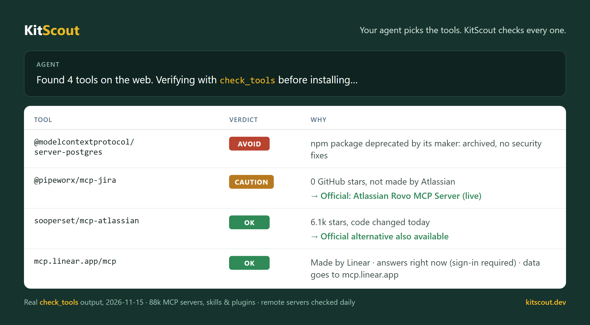

# KitScout: check agent tools before you install them

[](https://registry.modelcontextprotocol.io/v0/servers?search=dev.kitscout)
[](#install)
[](plugins/kitscout/skills/find-agent-tools/SKILL.md)
[](LICENSE)

**The trust check between your agent and the tools it installs.** Your agent finds tools on the web. Some of them are deprecated, abandoned, unofficial copies, renamed or simply down. **KitScout checks every pick before it gets installed**, using an index of ~90,000 MCP servers, Agent Skills and Claude Code plugins (publisher identity, GitHub activity, a daily live check of every remote server) plus a live call at check time.



## Install

**Claude Code plugin** (skills + MCP server + stack guard, recommended):
```
/plugin marketplace add kitscout-dev/kitscout-plugin
/plugin install kitscout@kitscout
```

**MCP server only** (free, no API key, read-only): `https://mcp.kitscout.dev/mcp`

| Client | How |
|---|---|
| Claude Code | `claude mcp add --transport http kitscout https://mcp.kitscout.dev/mcp` |
| Claude app / claude.ai | Settings → Connectors → Add custom connector → `https://mcp.kitscout.dev/mcp` |
| Cursor, VS Code, Codex, others | add a remote (Streamable HTTP) MCP server with that URL. Step-by-step: https://kitscout.dev/mcp |

**Skill only** (any agent that supports Agent Skills):
```
npx skills add kitscout-dev/kitscout-plugin --skill find-agent-tools
```

## Use it

Just ask your agent as usual:

> "I want to build a program that makes YouTube Shorts and uploads them automatically. Where do I start?" (the skill splits the plan into steps and adds the ready-made tools that already do some of them)
>
> "I want a Slack message whenever a Jira issue is closed. Which tools should I use?"
>
> "Is `@modelcontextprotocol/server-postgres` still OK to install?"

You never call KitScout's tools yourself: describe the goal and your agent searches and checks on its own. With the plugin, the `find-agent-tools` skill asks at most 2 short questions, and only about the job itself (what should come out, from where, to where, how often), never about your setup. When a fact about your setup decides between two approaches, it shows both in one line each. Then it plans the workflow and runs `check_tools` on every MCP server, skill or plugin it recommends. It prefers a plain script, the product's own API or an established service when those fit better than an MCP server.

## Stack guard: warned when an installed tool breaks (plugin 1.1+)

Tools you already installed change under you: makers archive or deprecate them, stop maintaining them, remote servers go down, or a server quietly stops starting on your machine. With the plugin, KitScout checks **every MCP server and plugin installed in Claude Code** (not only ones KitScout found) and tells you at session start:

> KitScout: 2 of your 6 agent tools need attention: old-postgres (fails to start on this machine), ...

- **On your machine**: `claude mcp list` - does each server actually start here?
- **From KitScout's daily data**: archived repo, npm deprecation, no code changes for a year or more, remote server down in our daily check.
- Runs in the background at most once a day per project (the session-start hook itself returns instantly). Ask Claude *"KitScout stack report"* for details and replacements; it never installs or removes anything without your OK.
- **Privacy**: only public ids leave your machine (npm/PyPI/Docker package names, server URLs without query strings or secret-looking path parts, plugin names). Never env vars, arguments, keys or files. Anonymous "did it start" sharing helps everyone see broken tools; it is **off** unless you ask Claude to turn it on.
- Needs Node.js (most MCP setups already have it).

## What `check_tools` looks at

Pass up to 5 GitHub URLs, npm/PyPI package ids, remote MCP URLs or names per call.

| Check | Example result |
|---|---|
| Made by the product's own company? | `first_party`, or "not made by Atlassian" + the official server |
| Deprecated, archived or renamed? | npm deprecation notice → `avoid`; renamed repo → new name |
| Maintained? | days since last code change |
| Adopted? | GitHub stars |
| Does the remote server answer **right now**? | live call during the check (plus our daily check history) |
| Where does your data go? | "local: runs on your machine" or "remote: data goes to mcp.example.com" |

Verdict: **`ok`**, **`caution`** (low adoption, slow maintenance, unofficial) or **`avoid`** (deprecated, archived, down, abandoned), plus better or official alternatives that fit the same job.

## Why verify

We took 18 tools an agent picked by plain web search for real tasks and ran them through `check_tools`. It flagged both weak picks (a 0-star repo untouched for 231 days, a 10-star scraper) and offered better-maintained alternatives, resolved 3 renamed repos to their new names, and left the good picks alone: 2 picks improved, 16 unchanged, 0 false "avoid". In a second test on 8 multi-step workflows it caught an archived WordPress server that web search had recommended.

## Other tools in the MCP server

| Tool | What it does |
|---|---|
| `search_tools` | Ranked search across MCP servers, skills and plugins, with filters for verified publishers, live servers and servers that work without an API key. |
| `get_tool` | Full details for one tool, including the actual tool list a remote server exposes and a ready-to-paste connect/install line. |
| `list_categories` | All categories with tool counts. |

You can also browse the whole index at **https://kitscout.dev**.

## Privacy

The MCP server keeps a log of calls (time to the minute, country code, client app name, what you searched or checked, and the results) to learn which tools agents need. The stack guard sends public tool ids only, logged the same way. No IP addresses, accounts, headers or file contents. Policy: https://kitscout.dev/privacy

## Links

Server source: [kitscout-dev/kitscout-mcp](https://github.com/kitscout-dev/kitscout-mcp) · Website: https://kitscout.dev · Wrong verdict or missing tool? [Open an issue](https://github.com/kitscout-dev/kitscout-plugin/issues) or email contact@kitscout.dev · License: MIT
